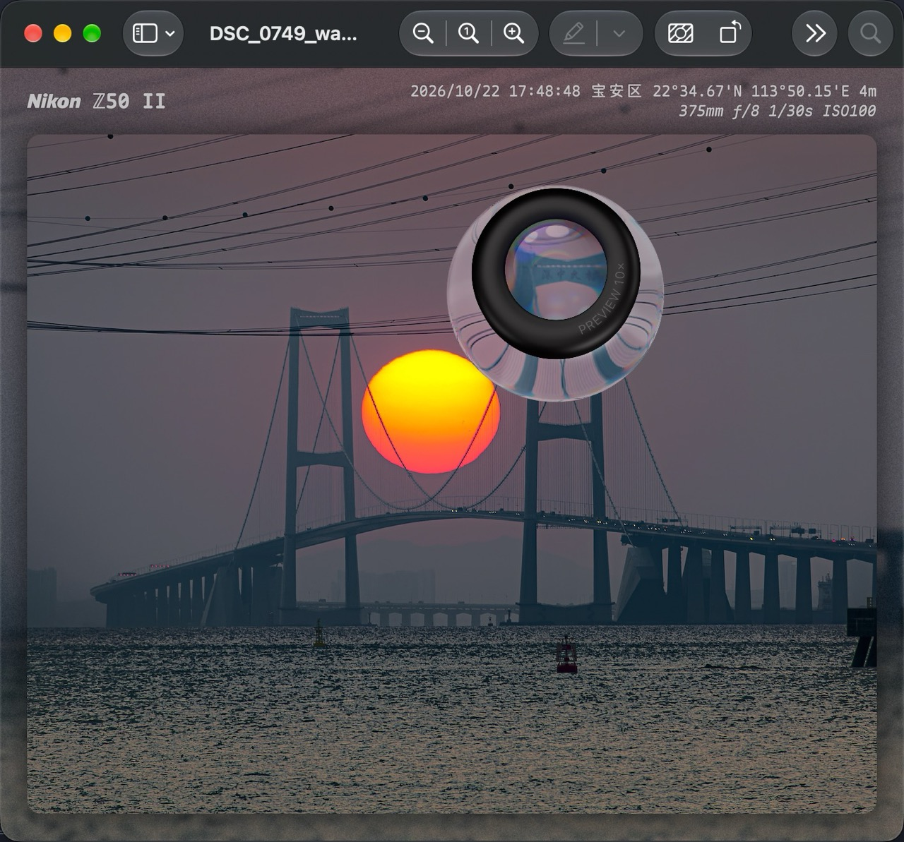

# macOS Loupe

用来娱乐的小程序。

macOS 26 和 27 上的观片镜，复刻 iOS 和 iPadOS 预览内置的观片镜。

它使用 iOS「预览」首页的原版镜筒和玻璃图层，折射浮窗下方的桌面与其他 App。



## 使用

1. 启动 **macOS Loupe**，点菜单栏的观片镜图标，选择 **显示观片镜**。
2. 首次使用时，在 **系统设置 → 隐私与安全性 → 屏幕与系统音频录制** 中允许 macOS Loupe 录制屏幕。授权后再次显示镜头，必要时重开 App。
3. 按住镜头时会旋转并抬起，松手后按落点和横向拖动速度回到对应朝向。右键镜头，选择 **移除观片镜**，或从菜单栏移除。

在菜单栏选择 **观片镜大小…**，可实时调整镜头直径（100–260 pt，默认 160 pt）。尺寸会保留到下次启动。

勾选 **打开「预览」时显示** 后，只要 macOS Loupe 在菜单栏运行，切换到系统「预览」时就会自动显示。这个选项默认关闭。右键移除后，当前这次使用「预览」期间会保持隐藏。

屏幕帧用于实时渲染，浮窗自身从采集画面中排除。移除镜头时会停止采集。

## 构建

本仓库不含 iOS「预览」的资源包，需自行从 iOS 27/26 模拟器中导出。

安装并挂载带有「预览」的 iOS 27 模拟器运行时，然后在工程根目录运行：

```sh
./Scripts/import-loupe.sh
open macOS-loupe.xcodeproj
```

也可以给导入脚本传入本机 `LandingUI-Loupe.ca` 包的路径。导入后的 Apple 资源保存在本地并由 Git 忽略。

在 Xcode 中运行 **macOS Loupe** scheme，或在终端构建并打开：

```sh
xcodebuild -project macOS-loupe.xcodeproj -scheme 'macOS Loupe' \
  -configuration Release -derivedDataPath build build
open 'build/Build/Products/Release/macOS Loupe.app'
```

应用使用 Swift、AppKit、ScreenCaptureKit 和 Metal。原版 CAML 包由 Objective-C 桥接到 QuartzCore 私有 API，适用于本地构建。Deployment Target 为 macOS 26.0，运行验证在 macOS 27.2 上完成。
